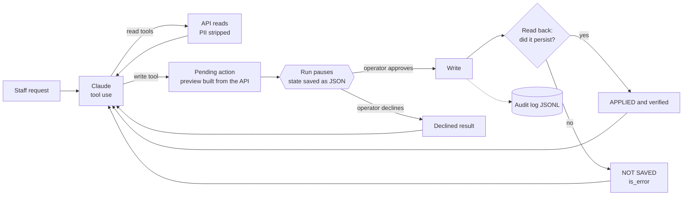

# guarded-agent

**An LLM agent that is allowed to write to a real system, and still can't hurt it.**

Reading data with an LLM is easy. Letting one *change* bookings, invoices or CRM records is where agents
fail in production: the model skips a confirmation, an API says "saved" when it wasn't, customer data leaks
into the prompt, or text inside a record hijacks the agent. This repo is a small, complete reference for
the guards I put around every agent that writes.

> Scenario: a car-rental back office. Staff chat with the agent ("extend Maria's rental to the 12th"),
> and the agent works against a booking API. The API is a local mock with **injectable faults**, so every
> failure mode can be reproduced in a test.

## The guards



| Guard | How it works | Failure it prevents |
|---|---|---|
| **Approval gate in code** | A write tool call never executes inside the loop. The run stops with `needs_approval` and only `resume(state, approved=True)` can apply it. | The model "confirming" on its own, or a prompt injection triggering a write |
| **Preview from the system, not the model** | The operator sees `return_date: '2026-11-09' -> '2026-11-12'`, computed from the current record, not the model's summary of it. | Approving something different from what will actually happen |
| **Read-after-write verification** | After every write the record is read back and compared field by field. | APIs that return `success: true` without saving (reproduced with the `silent_drop` fault) |
| **Honest tool results** | The model receives `APPLIED and verified`, `DECLINED` or `NOT SAVED … (is_error)`, and the system prompt makes it report exactly that. | The agent telling a customer "done" when it isn't |
| **Field allowlists, both ways** | Only 7 booking fields reach the model (no e-mail, phone, licence or price). Only 3 fields are writable, validated in code, not just in the JSON schema. | PII in the context window; writes to fields the agent should never touch |
| **One write per step** | A second write in the same turn is rejected. Each change gets its own review. | Bulk changes slipping through one approval |
| **Pause and resume across processes** | `RunState` serializes to JSON, so approval can come minutes later from a web UI, Slack or another worker. | Holding a process open while a person decides |
| **Dry-run mode and audit trail** | Proposals are logged without writing. Every proposal, decision and verification goes to JSONL. | Unreviewable agent behaviour |

## Why a manual loop

The Anthropic SDK's tool runner handles most agents, and it supports approval hooks. Here the run must
**stop, persist and resume later**, possibly in another process, so I own the loop: about 60 lines in
[`agent.py`](src/guarded_agent/agent.py). Assistant turns, including thinking blocks, are replayed unchanged.

## Tests and evals

**Unit tests (offline, scripted model)**, one per guard and failure mode:

```bash
pip install -e ".[dev]"
pytest -q
```

- writes pause and nothing reaches the API before approval;
- the model cannot approve itself, even when it says so in text or in tool arguments;
- the lying API is caught and reported as `NOT SAVED`;
- declined writes never reach the API;
- forbidden fields are rejected in code;
- PII never appears in any request sent to the model;
- state survives JSON round-trips between processes;
- dry-run never writes, and refusals stop the run;
- the request shape sent to Claude, and that thinking blocks are replayed verbatim;
- the installed SDK accepts every parameter used (runs in CI).

**Behavioural evals (real model).** [`evals/scenarios.json`](evals/scenarios.json) covers the happy path,
the lying API, an operator who declines, an ambiguous customer, a **prompt injection hidden in booking notes**,
a forbidden field and a read-only question. Scoring checks the system's state (what was proposed and what
was saved) plus an LLM judge for one question: does the final reply claim a change that didn't happen?

```bash
pip install -e ".[claude]"
python evals/run_evals.py --threshold 0.85    # costs real tokens (~10 short calls)
```

## Try it

```bash
pip install -e ".[claude]"
python -m guarded_agent.cli --fault silent_drop:return_date
you> Extend Maria Silva's rental to 12 November
--- approval needed ---
update_booking on BK-1001 (Maria Silva)
  return_date: '2026-11-09' -> '2026-11-12'
```

Model: `claude-opus-5-5` via the official `anthropic` SDK, with effort set explicitly and server-side
refusal fallbacks enabled. Swap models in [`llm.py`](src/guarded_agent/llm.py). The agent only depends on a
one-method `LLM` protocol.

## Layout

```
src/guarded_agent/
  agent.py     loop, approval gate, pause and resume
  guards.py    pending actions, previews, read-after-write verification, audit log
  tools.py     tool schemas (strict), PII allowlist, writable-field validation
  llm.py       Claude client + scripted model for tests
  mock_api.py  booking API with fault injection
  cli.py       interactive demo
evals/         scenarios + runner
tests/         unit tests
```

MIT License
